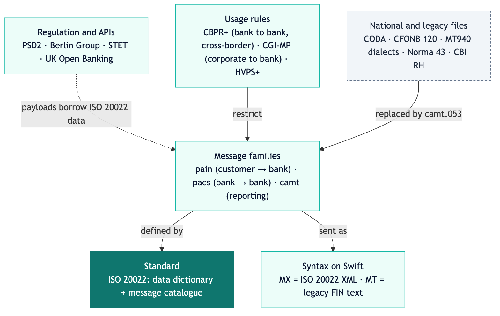
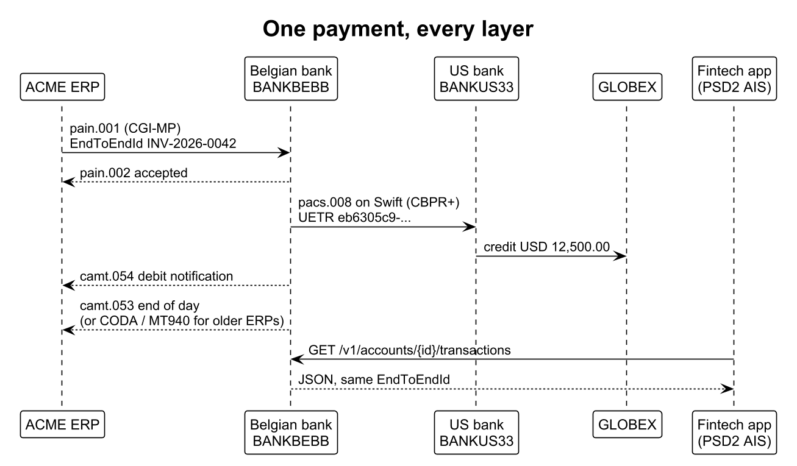

# Demystifying banking formats


[](LICENSE)
[](examples/pom.xml)
[](examples/pom.xml)
[](https://www.iso20022.org/)
[](docs/diagrams)
[](https://github.com/wallaceespindola/demystify-banking-formats/actions/workflows/ci.yml)

ISO 20022, pain, pacs, camt, MT, MX, CBPR+, CGI-MP, CODA, PSD2. These are not ten competing formats. They are
layers of one stack, and each answers a different question: which standard defines the data, who talks to whom,
what the bytes look like on the wire, which rules apply on a given route, what your ERP still imports, and who is
allowed to read the account.

This repository puts the layers side by side, follows one payment and one statement through all of them, and
backs it with sample files and small Java examples you can run.



## The stack at a glance

| Layer | Question it answers | Examples |
| --- | --- | --- |
| Standard | Which rulebook defines the data? | ISO 20022 |
| Message family | Who talks to whom about what? | pain (customer to bank), pacs (bank to bank), camt (reporting) |
| Syntax on Swift | What does it look like on the wire? | MT (FIN text), MX (ISO 20022 XML) |
| Usage rules | Which fields, lengths and codes are allowed here? | CBPR+, CGI-MP, HVPS+ |
| National and legacy files | What does my ERP still import? | CODA (BE), CFONB 120 (FR), MT940 (DE), Norma 43 (ES), CBI RH (IT) |
| Regulation and APIs | Who may access the account, and how? | PSD2, Berlin Group NextGenPSD2, STET |

## One payment, every layer

ACME NV in Brussels pays GLOBEX in the US USD 12,500.00, and receives 250.00 EUR from a Belgian customer. The
same payment and the same statement appear in every sample file in this repository.



| Sample | Format | What to look at |
| --- | --- | --- |
| [payment.pain001.xml](docs/samples/payment.pain001.xml) | pain.001.001.09 | Group header, payment information, one transaction: the three levels |
| [payment.pacs008.xml](docs/samples/payment.pacs008.xml) | pacs.008.001.08 | UETR, EndToEndId, structured addresses |
| [statement.camt053.xml](docs/samples/statement.camt053.xml) | camt.053.001.08 | Balances, one entry, structured creditor reference |
| [statement.coda](docs/samples/statement.coda) | CODA | 128-character records, Belgian OGM/VCS reference |
| [statement.mt940](docs/samples/statement.mt940) | MT940 | Tags, and the free-text `:86:` field |
| [make-run-output.txt](docs/samples/make-run-output.txt) | `make run` output | What the examples print: the three parsed statements and the MT103 with its loss report |

## Run the examples

The Java module reads the same statement from CODA, MT940 and camt.053 into one model, and translates the pacs.008
to an MT103 while listing what gets lost. JDK only, no third-party parsing library.

```bash
make examples   # build and run the JUnit 5 tests (Java 25, Maven)
make run        # print the three parsed statements and the MT103 translation
```

The run ends with this (trimmed):

```text
Same statement in all three formats: true

:59:/123456789
Globex Corporation International Ho
North Industrial Park Boulevard 120
62701 Springfield IL US

Lost in translation:
  - :59: name truncated, lost "ldings LLC"
  - :59: street truncated, lost "0"
  - EndToEndId INV-2026-0042 has no MT103 field (kept only if the bank maps it to :70:)
```

The building number 1200 becomes 120. That is the kind of loss the move to ISO 20022 was meant to end.

## Documentation

| Path | Contents |
| --- | --- |
| [docs/spec/PRD-banking-formats-map.md](docs/spec/PRD-banking-formats-map.md) | The idea, the story, what the examples prove, and the dated facts (checked against Swift, Febelfin, the Federal Reserve and EUR-Lex) |
| [docs/context.md](docs/context.md) | Research notes: every message family, MT94x, national formats per country with samples, pitfalls |
| [docs/glossary.md](docs/glossary.md) | Every acronym used in this repository |
| [docs/samples/](docs/samples) | The sample files |
| [docs/diagrams/](docs/diagrams) | Shared diagram sources and PNGs |
| [examples/](examples) | Java 25 parsers, translator and tests |
| [docs/presentations/](docs/presentations) | Talk deck: Marp source, PDF, editable PPTX ([import guide](docs/presentations/GOOGLE_SLIDES.md)) |

The sample files are trimmed for teaching. Validate against the official XSD, the CBPR+ or CGI-MP usage guideline
and your bank's implementation guide before using any of them in production.

## Development

```bash
make help       # list targets
make examples   # Java build and tests
make diagrams   # render .puml (plantuml) and .mmd (mermaid-cli) to PNG
make lint       # markdownlint
make links      # offline link check (needs lychee)
make slides     # export the Marp deck to PDF
make pptx       # build the editable PPTX
```

CI builds the Java examples and runs the Markdown lint and link check on every push and pull request.

## Support

If you find this project helpful, please consider:

[](https://www.buymeacoffee.com/wallace.espindola)
[](https://github.com/wallaceespindola/demystify-banking-formats)

[](https://github.com/wallaceespindola/demystify-banking-formats/stargazers)
[](https://github.com/wallaceespindola/demystify-banking-formats/network/members)
[](https://github.com/wallaceespindola/demystify-banking-formats/watchers)
[](https://github.com/wallaceespindola/demystify-banking-formats/issues)
[](https://github.com/wallaceespindola/demystify-banking-formats/commits/main)

Star the repo on GitHub if it saves you a trip through a 200-page usage guideline.

## Author

Wallace Espindola, Solution Architect

- Email: <wallace.espindola@gmail.com>
- LinkedIn: <https://www.linkedin.com/in/wallaceespindola/>
- GitHub: <https://github.com/wallaceespindola/>

## License

[MIT](LICENSE)
