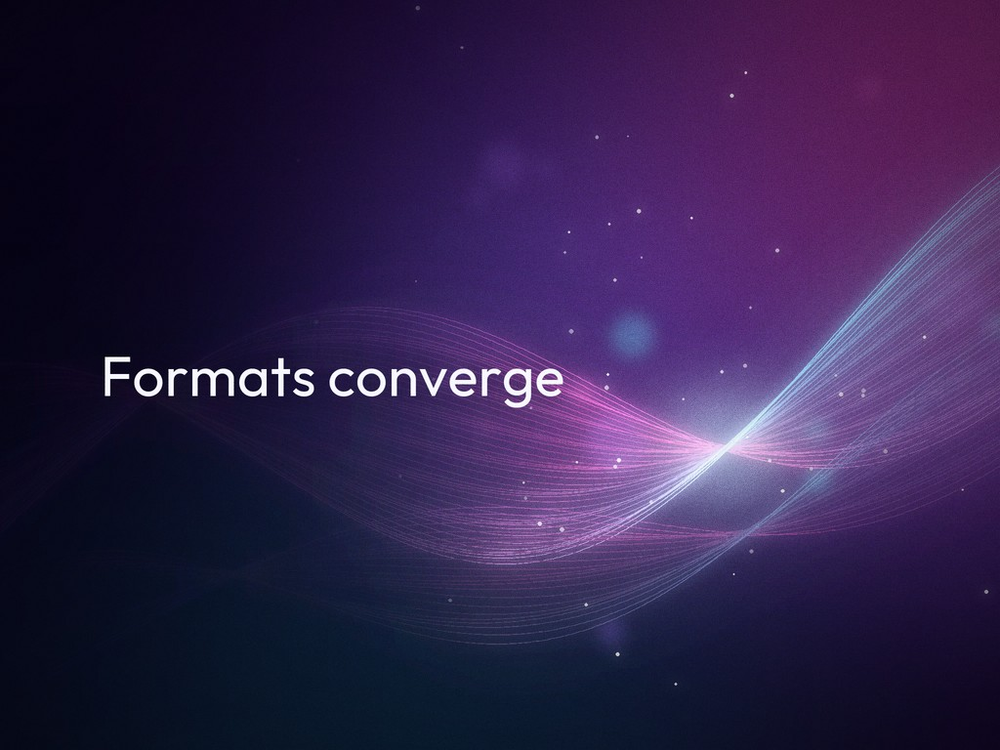

<!--
Meta description: How banking message standards converged from national fixed-width files and Swift MT to ISO 20022, why the result is a layered stack, where translation loses data and what comes next.
Tags: ISO 20022, payments architecture, Swift MT, CBPR+, camt.053, PSD3, data migration, integration patterns
-->



# From Fixed-Width Files to ISO 20022: How Banking Message Standards Converged

**Key Takeaways**

- The acronyms around payments (ISO 20022, pain, pacs, camt, MT, MX, CBPR+, CGI-MP, CODA, PSD2) are layers of one stack rather than competing formats, and treating them as alternatives leads to the wrong architecture decisions.
- ISO 20022 behaves like a canonical data model with several representations, so an integration design should map every bank format into one internal model instead of translating each format directly into the others.
- Translating ISO 20022 data back into MT or into a fixed-width national file loses information by construction, so every remaining translation point in an estate should be listed and treated as a data quality risk.
- Usage rules such as CBPR+ and CGI-MP, not the base XML schema, decide whether a message is accepted, and the deferred structured address deadline shows that these dates can move while the data work behind them stays the same.
- PSD2 and the agreed but not yet in force PSD3 and PSR regulate access to accounts rather than message formats, and because the resulting APIs borrow ISO 20022 data elements, a clean internal ISO 20022 model also pays off on the API side.

---

*By Wallace Espindola, Solution Architect · [wallace.espindola@gmail.com](mailto:wallace.espindola@gmail.com) · [LinkedIn](https://www.linkedin.com/in/wallaceespindola/) · [GitHub](https://github.com/wallaceespindola/)*

*Companion repository with the sample files, the Java examples and the diagrams discussed here: [github.com/wallaceespindola/demystify-banking-formats](https://github.com/wallaceespindola/demystify-banking-formats)*

---

## Most writing on payment formats stops at one format

Engineers who join a payments, treasury or ERP integration team meet a dense set of acronyms in the first week: ISO 20022, pain, pacs, camt, MT, MX, CBPR+, CGI-MP, CODA and PSD2. The material available tends to sit at one of two extremes. Vendor pages explain why a product supports "all formats", and usage guidelines run to hundreds of pages about a single message. Neither explains how the pieces relate.

The result is a recurring architectural mistake. Teams compare MT940 with camt.053, or "MT with ISO 20022", or "the XML" with PSD2, as if they were rival options on one axis. The acronyms answer different questions: which rulebook defines the data, who is talking to whom, what the bytes look like on a given network, which subset of fields a given path accepts, what an older ERP still imports, and who may access an account at all.

This article looks at how those layers came about, why the convergence on ISO 20022 produced a stack and not a single format, where the stack loses data when it has to translate, and what the next dated changes are. It is an analysis of a pattern, not a migration guide. The examples come from an open repository that follows one payment and one bank statement through every layer, with trimmed teaching samples and a small Java 25 module that parses and translates them. There is no adoption data in that repository, and this article does not offer any percentages or cost figures.

## Three generations of bank messages

The formats in use today come from three periods, and all three are still visible in a typical corporate or bank integration estate.

### National fixed-width files

Many countries built their own statement and payment files for domestic banking: CODA in Belgium, CFONB 120 in France, Norma 43 in Spain and CBI RH in Italy, with MT940 dialects playing a similar role in Germany. These are files that accounting systems import to reconcile accounts. Their design reflects the systems they were built for: fixed record lengths, a record type in the first column and meaning determined by character position.

CODA is a useful example because it is still maintained. Febelfin publishes the specification, and the [current version is 2.7](https://febelfin.be/media/pages/publicaties/2023/febelfin-standaarden-voor-online-bankieren/5d601609cd-1754302976/standard-coda-2.7-en.pdf), with version 2.6 dated February 2018. Every record is 128 characters. A parser does not look for tags or elements; it cuts substrings at fixed offsets. That makes the files compact and easy to process, and it means any field the original designers did not foresee either does not exist or ends up in a free-text zone.

### Swift MT: tags and 35-character lines

The Swift MT messages (FIN text) brought a shared syntax to cross-border banking. An MT103 carries a customer credit transfer, and an MT940 carries a customer statement. MT uses numbered tags such as `:32A:` for value date, currency and amount, or `:59:` for the beneficiary. It is more self-describing than a fixed-width file, but it inherited the same constraint: parties and addresses are free text in lines of 35 characters, with a small number of lines per field.

The weak point of MT for reporting is the `:86:` field of the MT940, the information to the account owner. It is free text, and banks structure it in their own ways. In the repository, the statement entry carries the Belgian structured reference inside that free text:

```text
:61:2611241124CR250,00NTRFNONREF//0000000000000001
:86:DUPONT SA +++123/4567/89002+++
```

A parser has to know where that bank puts the counterparty name and the reference. In practice that makes "MT940 support" a set of bank-specific parsers rather than one.

### ISO 20022: a data model with many representations

ISO 20022 is a different kind of thing from both earlier generations. It is a business model and a data dictionary from which message definitions are derived. Those definitions are grouped into business areas: `pain` for customer to bank (payment initiation), `pacs` for bank to bank (clearing and settlement) and `camt` for cash management and reporting. The XML schemas that most people think of as "ISO 20022" are one representation of that model.

On the Swift network, ISO 20022 XML messages are called MX. An MX pacs.008 and a pacs.008 sent through a domestic clearing system are the same message definition. "MT versus MX" is therefore a comparison between two syntaxes on one network, while "MT versus ISO 20022" is a comparison between a syntax and a data model. The second phrasing is the more accurate one.

## The convergence, in dated steps

The move from MT to ISO 20022 did not happen in one event. Market infrastructures migrated one by one, the Swift cross-border coexistence period ended later, and the regulatory track ran in parallel.

![Timeline of dated milestones: PSD2 Directive (EU) 2015/2366 in 2015, Febelfin CODA 2.6 dated February 2018, T2 migration in March 2023, CHAPS in June 2023, Fedwire Funds cutover on 14 July 2025, Verification of Payee mandatory on 9 October 2025, end of Swift MT/MX coexistence on 22 November 2025, PSD3 and PSR provisional agreement on 27 November 2025, Swift accepting the structured address extension in August 2026, the original 14 November 2026 address cut-off now deferred, and the deferred SR 2026 release on 12 June 2027](diagrams/convergence-timeline.jpg)

*Figure 1: Dated milestones, grouped by track. Blue: regulation and national files. Teal: market infrastructures. Brown: Swift cross-border and EU payment rules. Violet: changes that are agreed, scheduled or deferred.*

The high-value systems went first. The Eurosystem's T2 migrated in March 2023 and the Bank of England's CHAPS in June 2023. In the United States, Fedwire Funds [moved to ISO 20022 in a single-day cutover on 14 July 2025](https://frbservices.org/news/press-releases/071525-iso20022-migration-announcement), a different strategy from the coexistence periods used elsewhere.

On the Swift network, MT and MX ran side by side for cross-border payment instructions until [coexistence ended on 22 November 2025](https://www.swift.com/insights/news/iso-20022-bytes-payments-journey-continues). That date is often read as "MT is gone". It is more precise to say that MT is gone as the format for cross-border payment instructions on Swift. Statement formats such as MT940 and the national files are a separate question, decided by banks and their customers, and the camt messages that replace them are explicitly outside some of the rules discussed below.

The regulatory track is older and moves on its own schedule. PSD2, [Directive (EU) 2015/2366](https://eur-lex.europa.eu/eli/dir/2015/2366/oj), opened account access to licensed third parties. The [Instant Payments Regulation (EU) 2024/886](https://eur-lex.europa.eu/eli/reg/2024/886/oj) made Verification of Payee mandatory for euro credit transfers in the eurozone from 9 October 2025. Neither defines a message format, which is the first hint that the stack has a layer that is not about syntax at all.

## The layered model as an architectural pattern

Once the history is laid out, the acronyms sort into six layers, each answering one question:

| Layer | Question it answers | Examples |
| --- | --- | --- |
| Standard | Which rulebook defines the data? | ISO 20022 |
| Message family | Who talks to whom about what? | pain, pacs, camt |
| Syntax on Swift | What does it look like on the wire? | MT (FIN text), MX (ISO 20022 XML) |
| Usage rules | Which fields, lengths and codes are allowed here? | CBPR+, CGI-MP, HVPS+ |
| National and legacy files | What does the ERP still import? | CODA, CFONB 120, MT940 dialects, Norma 43, CBI RH |
| Regulation and APIs | Who may access the account, and how? | PSD2, Berlin Group NextGenPSD2, STET |

For an architect, the more useful view is the shape this stack takes. It is a familiar integration pattern: a canonical data model at the center, constrained by profiles, exposed through several representations, some of which cannot hold the full model.


*Figure 2: The stack as a hub with representations. Teal: the shared data model. Light green: representations that keep the full model. Grey: legacy representations with fixed field sizes. Amber: usage rules. Violet: regulation, which governs access rather than format. Red dashed arrows: translations that drop or truncate data.*

Three properties of this pattern carry most of the design consequences.

First, the hub is a data model. Every representation that can hold the full model (XML today, and JSON payloads in some APIs) is interchangeable at the data level. Representations that cannot hold it (MT, CODA, the other national files) are lossy views. That makes the direction of any translation important: mapping a CODA record into an ISO 20022-shaped model is safe, while producing a CODA record or an MT103 from ISO 20022 data is where information disappears.

Second, profiles decide acceptance. CBPR+ restricts ISO 20022 messages for cross-border bank-to-bank traffic on Swift, CGI-MP does the same for corporate-to-bank files, and HVPS+ for high-value payment systems. They narrow cardinalities, lengths and code lists. A pain.001 that validates against the base schema can still be rejected by a bank whose guideline is stricter. Validation therefore belongs at the profile layer, not only at the schema layer, and profiles are versioned on their own release cycles.

Third, regulation sits beside the stack. PSD2 created an obligation to provide account access, and market bodies such as the Berlin Group and STET defined REST APIs to meet it. Those APIs are not an ISO 20022 syntax, but their payloads reuse ISO 20022 concepts and names for amounts, parties, end-to-end identifiers and remittance information. An organization that keeps its internal model close to ISO 20022 has less mapping to do on the API side.

The practical consequence for system design is the canonical model pattern. In the repository, three statement formats (CODA, MT940 and camt.053) are parsed into one Java record, `Statement`, and the example run compares the three results:

```text
Same statement in all three formats: true
```

The parsers differ completely in technique (positions, tags, XML elements), but downstream code sees one model. That is the anti-corruption layer applied to bank formats: format knowledge stays at the edge, and a change of bank or format becomes a new adapter while reconciliation logic stays as it is.

## Translation loss is the main migration risk

Coexistence periods, legacy back-office systems and customers who still import MT messages all create translation points between the rich model and the older representations. In the direction from ISO 20022 to MT, those points lose data by construction.

The repository's story follows ACME NV in Brussels paying a US supplier USD 12,500.00. The bank-to-bank leg is a pacs.008 under CBPR+, and its creditor block is fully structured (BICs in the sample are fictional, `BANKBEBB` and `BANKUS33`):

```xml
      <Cdtr>
        <Nm>Globex Corporation International Holdings LLC</Nm>
        <PstlAdr>
          <StrtNm>North Industrial Park Boulevard</StrtNm>
          <BldgNb>1200</BldgNb>
          <PstCd>62701</PstCd>
          <TwnNm>Springfield</TwnNm>
          <CtrySubDvsn>IL</CtrySubDvsn>
          <Ctry>US</Ctry>
        </PstlAdr>
      </Cdtr>
```

The example translator, a teaching example and not a CBPR+ translator, maps the core fields into an MT103 and reports what did not fit. This is the relevant part of its real output, trimmed to the `:59:` field and the loss report:

```text
:59:/123456789
Globex Corporation International Ho
North Industrial Park Boulevard 120
62701 Springfield IL US
...
Lost in translation:
  - :50K: structured address (StrtNm, BldgNb, PstCd, TwnNm, Ctry) flattened to free text
  - :59: name truncated, lost "ldings LLC"
  - :59: street truncated, lost "0"
  - :59: structured address (StrtNm, BldgNb, PstCd, TwnNm, Ctry) flattened to free text
  - EndToEndId INV-2026-0042 has no MT103 field (kept only if the bank maps it to :70:)
```

Three kinds of loss show up in this small sample, and each has a different consequence.

- **Truncation:** the creditor name loses its legal form, and the building number 1200 becomes 120. Nothing in the MT103 signals that a character was cut, so a downstream reader sees a plausible but wrong address.
- **Flattening:** the address keeps its text but loses its structure. A system that needs the town or the country as a field now has to parse free text, which is exactly what ISO 20022 set out to remove.
- **Dropped identifiers:** the EndToEndId, which the payer uses to reconcile the payment with an invoice, has no MT103 field. The UETR survives in the header (block 3, field 121), but the reference the customer cares about depends on the bank's mapping choices.

These losses matter beyond reconciliation. Party names and addresses are inputs to sanctions screening and payment transparency checks, so a truncated or flattened party is a compliance concern as well as a data quality one. The repository does not contain error rates or incident data, and this article does not estimate them. The structural point stands without numbers: any remaining ISO 20022 to MT translation point is a place where data is lost, and the loss is silent unless the translator reports it.

For architects, that suggests an inventory exercise. List every place where data moves from the canonical model into a narrower representation, decide whether each one is still needed, and where it is, make the translator emit a loss report like the one above rather than truncating quietly.

## Where it goes next

Three changes are visible from the dated record, and they sit on different layers of the stack.

### Structured addresses, with a moving deadline

CBPR+ was due to reject unstructured postal addresses from 14 November 2026. Under the [Swift rule](https://www.swift.com/standards/iso-20022/removal-unstructured-address), town and country must be in their own fields at a minimum, and the hybrid option allows two address lines of 70 characters alongside them. In August 2026, Swift [accepted a community request to extend the structured address migration](https://www.swift.com/news-events/news/swift-accepts-community-request-extend-structured-address-migration-iso-20022-payment-messages). The deferred SR 2026 release moves to 12 June 2027, and the timing for the address change is under consultation, with an update expected by December 2026, as [Finextra also reported](https://www.finextra.com/newsarticle/48318/swift-accepts-request-to-extend-structured-address-migration-for-iso-20022-messages).

Moving the deadline does not reduce the work. Most of the effort behind structured addresses sits in master data: customer and supplier records that hold an address as two free-text lines cannot produce a `TwnNm` and a `Ctry` without cleansing. The extension gives organizations more time for that work. The rule also has a defined scope. According to the [Swift FAQ](https://www.swift.com/standards/iso-20022/iso-20022-faqs/iso-20022-removal-unstructured-address), camt.052, camt.053 and camt.054 are excluded from the CBPR+ structured address rule, so the reporting side is not under the same pressure.

### PSD3 and PSR: agreed, not yet in force

PSD3 and the Payment Services Regulation (PSR) reached a [provisional political agreement on 27 November 2025](https://www.nortonrosefulbright.com/en/knowledge/publications/cedd39c6/psd3-and-psr-from-provisional-agreement-to-2026-readiness), followed by Council and ECON approvals in spring 2026. Formal adoption and publication in the Official Journal had not been confirmed when the facts for this article were checked, so the accurate status is "agreed, not yet in force". In the layer model, these texts sit where PSD2 sits: they govern access and obligations, not syntax. Their effect on message formats is indirect, through the APIs and checks that providers build to comply.

Verification of Payee is a useful precedent for that indirect effect. It is a regulatory obligation that defines no format, yet it depends on the payee name being available and comparable, which again comes back to party data quality.

### APIs borrow ISO 20022 data

The account information and payment initiation APIs that grew out of PSD2 are JSON over HTTP. They are not ISO 20022 messages, but their payloads reuse ISO 20022 data elements, and the repository's diagram marks that relation as "payloads borrow ISO 20022 data". The trend is convergence at the data layer while syntaxes multiply: XML on clearing networks, JSON on APIs and legacy text and fixed-width files where customers still need them.

For an internal architecture, that argues for keeping the canonical model independent of any one syntax, close to the ISO 20022 dictionary in names and structure, with serialization to XML, JSON or legacy files handled at the edges.

## Limits of the layered view

The layer model is a simplification, and it has limits worth stating.

- **Profiles diverge in practice:** CGI-MP aims for one corporate-to-bank dialect, but individual banks still publish their own guidelines on top of it. The model says "usage rules constrain the standard"; it does not say there is one set of rules per path.
- **Versions coexist:** several versions of the same message definition can be in use at the same time between different counterparties. A canonical model has to absorb that, which the repository's camt.053 parser does by ignoring the namespace version.
- **Legacy files have their own lifecycle:** the end of MT/MX coexistence applies to cross-border payment instructions on Swift. National statement files and MT940 follow decisions by banks and their customers, and there is no single date for their retirement in the dated record.
- **No adoption data:** the repository and this article contain no figures on how much traffic or how many organizations use each layer. Statements about direction are based on dated events.
- **The examples are teaching code:** the translator shows why loss happens. It does not implement CBPR+ translation rules, and the samples are trimmed to the fields that matter for the story.

## Conclusion

Banking message standards converged on a data model rather than on a file format. ISO 20022 sits at the center, usage rules decide what each path accepts, XML and JSON carry the full data, and MT and the national fixed-width files remain as narrower representations that lose information whenever data is pushed into them. Regulation runs beside the stack and shapes it through access obligations.

For architects, the pattern translates into a few concrete choices: one canonical model shaped by the ISO 20022 dictionary, adapters at the edge for each format, validation against the relevant usage rules and an explicit inventory of every lossy translation point. The structured address deferral and the pending PSD3 and PSR texts change the timing of the next steps. The direction stays the same. The companion repository at [github.com/wallaceespindola/demystify-banking-formats](https://github.com/wallaceespindola/demystify-banking-formats) has the samples and the code to explore the pattern on one payment and one statement.

## References

- Swift, [ISO 20022 in bytes: the payments journey continues](https://www.swift.com/insights/news/iso-20022-bytes-payments-journey-continues)
- Federal Reserve Financial Services, [Fedwire Funds Service ISO 20022 migration announcement](https://frbservices.org/news/press-releases/071525-iso20022-migration-announcement), July 2025
- Swift, [Removal of unstructured address](https://www.swift.com/standards/iso-20022/removal-unstructured-address)
- Swift, [Swift accepts community request to extend structured address migration for ISO 20022 payment messages](https://www.swift.com/news-events/news/swift-accepts-community-request-extend-structured-address-migration-iso-20022-payment-messages), August 2026
- Finextra, [Swift accepts request to extend structured address migration for ISO 20022 messages](https://www.finextra.com/newsarticle/48318/swift-accepts-request-to-extend-structured-address-migration-for-iso-20022-messages)
- Swift, [ISO 20022 FAQ: removal of unstructured address](https://www.swift.com/standards/iso-20022/iso-20022-faqs/iso-20022-removal-unstructured-address)
- Febelfin, [Standard CODA 2.7](https://febelfin.be/media/pages/publicaties/2023/febelfin-standaarden-voor-online-bankieren/5d601609cd-1754302976/standard-coda-2.7-en.pdf)
- Norton Rose Fulbright, [PSD3 and PSR: from provisional agreement to 2026 readiness](https://www.nortonrosefulbright.com/en/knowledge/publications/cedd39c6/psd3-and-psr-from-provisional-agreement-to-2026-readiness)
- EUR-Lex, [Directive (EU) 2015/2366 (PSD2)](https://eur-lex.europa.eu/eli/dir/2015/2366/oj)
- EUR-Lex, [Regulation (EU) 2024/886 (Instant Payments Regulation)](https://eur-lex.europa.eu/eli/reg/2024/886/oj)
- Companion repository with the samples, the Java examples and the diagrams: [github.com/wallaceespindola/demystify-banking-formats](https://github.com/wallaceespindola/demystify-banking-formats)

## About the author

**Wallace Espindola, Solution Architect**

Wallace Espindola is a senior software engineer and solution architect working across Java/Spring Boot and Python/FastAPI backends, cloud-native microservices on Kubernetes and OpenShift, and system architecture design. He maintains the open-source repository behind this article, which maps banking message formats as layers of one stack and shows, with samples and Java code, how one payment and one statement move through them.

Contact: [wallace.espindola@gmail.com](mailto:wallace.espindola@gmail.com) · [LinkedIn](https://www.linkedin.com/in/wallaceespindola/) · [GitHub](https://github.com/wallaceespindola/)

---

**Publishing note**: This article is submitted for InfoQ's 4-week exclusive publishing window. It will not be cross-posted to other platforms until that window closes.

---

**Examples repository:** every example in this article (the pacs.008 and MT940 samples, the pacs.008 to MT103 translator and its loss report, the canonical statement model and the diagrams) is in <https://github.com/wallaceespindola/demystify-banking-formats>.

Need more tech insights?

Check out my GitHub, LinkedIn, and Speaker Deck.

Happy coding!

Wallace Espindola, Solution Architect

- GitHub: <https://github.com/wallaceespindola/>
- LinkedIn: <https://www.linkedin.com/in/wallaceespindola/>
- Speaker Deck: <https://speakerdeck.com/wallacese>
- Email: <wallace.espindola@gmail.com>
