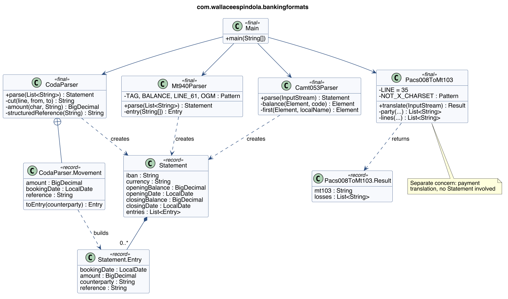

# Three statement formats, one Java model: parsing CODA, MT940 and camt.053 in Java 25

**By Wallace Espindola, Solution Architect**
<wallace.espindola@gmail.com> | [LinkedIn](https://www.linkedin.com/in/wallaceespindola/) | [GitHub](https://github.com/wallaceespindola/)

---

## Abstract

A Belgian bank can report the same account movement as a CODA file, an MT940 message or a camt.053 XML document: fixed-width text, tagged text and ISO 20022 XML. This article walks through a JDK-only Java 25 module that parses all three into one `Statement` record and proves with JUnit 5 that the results are equal: fixed positions and a pattern `switch` for CODA, the `:86:` dialect problem in MT940, XXE-safe DOM parsing for camt.053, and a pacs.008 to MT103 translator that reports what it loses.

---

## Introduction

Statement import code grows one format at a time: the national file from the first bank, MT940 from the second, and now camt.053, the ISO 20022 statement replacing the national files. Each format gets its own model, and reconciliation ends up knowing all of them.

The [demystify-banking-formats](https://github.com/wallaceespindola/demystify-banking-formats) repository takes the opposite route: one record, one parser per format, and a test that feeds the same movement in three syntaxes and expects the same object back. Every listing is copied from `examples/src`, and where I trimmed, a `...` line shows it. The files in `docs/samples` are trimmed teaching samples: one credit of 250.00 EUR from DUPONT SA with the Belgian structured reference `+++123/4567/89002+++`. The BICs `BANKBEBB` and `BANKUS33` are fictional.



## The canonical model

Everything downstream depends on this record:

```java
package com.wallaceespindola.bankingformats;

...

/** One bank statement, whatever file format it arrived in. Amounts are signed: credit positive, debit negative. */
public record Statement(
        String iban,
        String currency,
        BigDecimal openingBalance,
        LocalDate openingDate,
        BigDecimal closingBalance,
        LocalDate closingDate,
        List<Entry> entries) {

    /** One booked movement. {@code reference} is the structured creditor reference, digits only. */
    public record Entry(LocalDate bookingDate, BigDecimal amount, String counterparty, String reference) {}
}
```

Amounts are signed `BigDecimal`, so no parser leaks its credit/debit convention (`0`/`1` in CODA, `C`/`D` in MT940, `CRDT`/`DBIT` in camt.053). The reference is digits only, so `+++123/4567/89002+++` and `123456789002` compare equal. Records get value-based `equals`, so the cross-format test is one `assertEquals`, with a catch: `BigDecimal.equals` compares scale, and `250.00` is not equal to `250.000`. That's why every parser calls `setScale(2)`.

## CODA: positions, not separators

CODA is the Belgian statement file maintained by Febelfin (the current specification is [version 2.7](https://febelfin.be/media/pages/publicaties/2023/febelfin-standaarden-voor-online-bankieren/5d601609cd-1754302976/standard-coda-2.7-en.pdf)). Each record is 128 characters with the record type in column 1 (movements add a sub-type in column 2). The old balance and the first movement record from the sample:

```text
12001BE68539007547034                  EUR0000000001000000231126ACME NV                   CURRENT ACCOUNT                    001
21000100000000000000000000000000000000000250000241126001500001101123456789002                                      24112600100 1
```

The parser, package, imports and local declarations trimmed:

```java
...

/**
 * Reads the CODA records this example needs (Febelfin layout, 128 characters per line).
 * Positions in the comments are 1-based, as in the Febelfin specification.
 */
public final class CodaParser {

    private static final DateTimeFormatter DDMMYY = DateTimeFormatter.ofPattern("ddMMyy");

    public Statement parse(List<String> lines) {
        ...
        List<Statement.Entry> entries = new ArrayList<>();
        Movement pending = null;

        for (String line : lines) {
            if (line.length() != 128) {
                throw new IllegalArgumentException("CODA line must be 128 characters, got " + line.length());
            }
            switch (line.substring(0, 2)) {
                case String r when r.startsWith("0") -> { } // header: creation date, bank, addressee
                case String r when r.startsWith("1") -> {     // old balance
                    iban = cut(line, 6, 39).strip();             // account structure 2: IBAN in 6-39
                    currency = cut(line, 40, 42);
                    opening = amount(line.charAt(42), cut(line, 44, 58)); // sign in 43
                    openingDate = date(cut(line, 59, 64));
                }
                case "21" -> {                                 // movement, part 1
                    if (pending != null) {
                        entries.add(pending.toEntry(null));    // previous movement had no part 3
                    }
                    pending = new Movement(
                            amount(line.charAt(31), cut(line, 33, 47)),  // sign in 32
                            date(cut(line, 116, 121)),                    // entry date
                            structuredReference(line));
                }
                case "22" -> { }                               // movement, part 2: BIC, purpose codes
                case "23" -> {                                 // movement, part 3: counterparty
                    if (pending == null) {
                        throw new IllegalArgumentException("CODA record 23 without a preceding 21");
                    }
                    String counterparty = cut(line, 48, 82).strip();
                    entries.add(pending.toEntry(counterparty));
                    pending = null;
                }
                case String r when r.startsWith("8") -> {     // new balance
                    if (pending != null) {
                        entries.add(pending.toEntry(null));
                        pending = null;
                    }
                    closing = amount(line.charAt(41), cut(line, 43, 57)); // sign in 42
                    closingDate = date(cut(line, 58, 63));
                }
                default -> { }                                 // 3x information, 4 free text, 9 trailer
            }
        }
        return new Statement(iban, currency, opening, openingDate, closing, closingDate, List.copyOf(entries));
    }

    /** Communication type 1 in position 62, then "101" + 12 digits: the Belgian OGM/VCS reference. */
    private static String structuredReference(String line) {
        if (line.charAt(61) == '1' && cut(line, 63, 65).equals("101")) {
            return cut(line, 66, 77);
        }
        return null;
    }

    /** CODA amounts: 15 digits, 3 implied decimals; sign 0 = credit, 1 = debit. A non-zero third decimal fails fast. */
    private static BigDecimal amount(char sign, String digits) {
        BigDecimal value = new BigDecimal(digits).movePointLeft(3).setScale(2);
        return sign == '1' ? value.negate() : value;
    }

    ...

    /** Substring by 1-based, inclusive positions, the way the spec writes them. */
    private static String cut(String line, int from, int to) {
        return line.substring(from - 1, to);
    }

    ...
}
```

`cut` is the most useful helper here: the specification writes 1-based inclusive ranges, and `cut(line, 44, 58)` reads like it, so a reviewer checks each field against the PDF without converting offsets. The single-character reads (`line.charAt(42)` for "sign in 43") are the only 0-based indexes, and the comments say so.

The `switch` mixes two kinds of labels. Record types 0, 1 and 8 use a type pattern with a guard (`case String r when r.startsWith("1")`) because only the first character matters. Types 21, 22 and 23 are constant labels. A pattern `switch` must be exhaustive, and `default` covers that by skipping information (3x), free text (4) and trailer (9) records.

Amounts have 15 digits and 3 implied decimals, so `000000000250000` is 250.000. `movePointLeft(3)` restores the point and `setScale(2)` sets the model's scale. Without a rounding mode it throws `ArithmeticException` when the third decimal isn't zero, so a sub-cent amount stops the import. The Belgian OGM (or VCS) reference is communication type `1` in position 62, then `101` and twelve digits. A movement spans records 21 to 23, so the parser holds a `pending` `Movement` until record 23 brings the counterparty. A 21 without a 23 is booked with no counterparty; a 23 without a 21 throws.

## MT940: tags, and one field nobody agrees on

The same day as an MT940 message:

```text
{1:F01BANKBEBBAXXX0000000000}{2:O9401700261124BANKBEBBAXXX00000000002611241700N}{4:
:20:STMT-20261124
:25:BE68539007547034
:28C:001/1
:60F:C261123EUR1000,00
:61:2611241124CR250,00NTRFNONREF//0000000000000001
:86:DUPONT SA +++123/4567/89002+++
:62F:C261124EUR1250,00
-}
```

The parser, package and imports trimmed:

```java
...

/**
 * Reads a single-statement MT940 text block. Field 86 is free text, so the counterparty and
 * reference rules below are one bank's dialect: this is the part every bank does differently.
 */
public final class Mt940Parser {

    private static final DateTimeFormatter YYMMDD = DateTimeFormatter.ofPattern("yyMMdd");
    private static final Pattern TAG = Pattern.compile("^:(\\d{2}[A-Z]?):(.*)$");
    private static final Pattern BALANCE = Pattern.compile("([CD])(\\d{6})([A-Z]{3})([\\d,]+)");
    private static final Pattern LINE_61 = Pattern.compile("(\\d{2})(\\d{4})(\\d{4})?(R?[CD])([A-Z])?([\\d,]+).*");
    private static final Pattern OGM = Pattern.compile("\\+\\+\\+(\\d{3})/(\\d{4})/(\\d{5})\\+\\+\\+");

    public Statement parse(List<String> lines) {
        Map<String, String> header = new LinkedHashMap<>();
        List<String[]> statementLines = new ArrayList<>(); // pairs of :61: and :86:

        String lastTag = null;
        for (String line : lines) {
            Matcher tag = TAG.matcher(line);
            if (!tag.matches()) {
                if (line.startsWith("{") || line.startsWith("-}")) {
                    continue; // {1:}{2:}{4: block wrappers and the closing -}
                }
                if ("86".equals(lastTag) && !statementLines.isEmpty()) {
                    statementLines.getLast()[1] += " " + line.strip(); // :86: continues on up to 6 lines
                }
                continue;
            }
            lastTag = tag.group(1);
            switch (lastTag) {
                case "61" -> statementLines.add(new String[] {tag.group(2), ""});
                case "86" -> {
                    if (!statementLines.isEmpty()) {
                        statementLines.getLast()[1] = tag.group(2);
                    } // a :86: before any :61: describes the whole statement; not needed here
                }
                default -> header.put(lastTag, tag.group(2));
            }
        }
        ...
    }

    private static Statement.Entry entry(String[] pair) {
        Matcher m = LINE_61.matcher(pair[0]);
        if (!m.matches()) {
            throw new IllegalArgumentException("Unreadable :61: line: " + pair[0]);
        }
        String info = pair[1];
        Matcher ogm = OGM.matcher(info);
        String reference = ogm.find() ? ogm.group(1) + ogm.group(2) + ogm.group(3) : null;
        String counterparty = ogm.reset().replaceAll("").strip();
        // :61: starts with the value date (YYMMDD), then an optional entry date (MMDD): the booking date
        String bookingDate = m.group(3) != null ? m.group(1) + m.group(3) : m.group(1) + m.group(2);
        return new Statement.Entry(
                LocalDate.parse(bookingDate, YYMMDD), signed(m.group(4), m.group(6)), counterparty, reference);
    }

    ...
}
```

Where CODA asks "which column?", MT940 asks "which tag?". `TAG` splits each line into tag and value. Untagged lines after `:86:` are appended to it (it runs to six lines), and a `:86:` before the first `:61:` describes the whole statement, so it is ignored. `:60F:` and `:62F:` share one regex (mark, `yyMMdd` date, currency, decimal-comma amount), applied by the trimmed `balance` method. In the `:61:` line `CR250,00`, the mark is `C` and `R` is the optional funds code, hence `(R?[CD])([A-Z])?`, which also accepts the reversal marks `RC` and `RD`. The booking date is the optional entry date (`MMdd`, year from the value date) or else the value date. `signed` (trimmed) treats `D` and `RC` (reversal of a credit) as debits.

Then comes `:86:`, which is free text: `DUPONT SA +++123/4567/89002+++` is just how this fictional bank writes it. German banks structure it with `?20` to `?63` subfields, and others split the name over lines or omit the reference. The Javadoc calls these rules one bank's dialect. In a real system `entry` sits behind a per-bank strategy. camt.053 gives the same data named elements.

## camt.053: XML, namespaces and XXE

In camt.053 every value has a named element, for example `Ntry/BookgDt/Dt` and `Ntry/CdtDbtInd`. The parser, package and imports trimmed:

```java
...

/** Reads the first statement of a camt.053 file with the JDK's DOM parser, ignoring the version namespace. */
public final class Camt053Parser {

    public Statement parse(InputStream xml) throws Exception {
        DocumentBuilderFactory factory = DocumentBuilderFactory.newInstance();
        factory.setNamespaceAware(true);
        factory.setFeature("http://apache.org/xml/features/disallow-doctype-decl", true); // no XXE
        Document doc = factory.newDocumentBuilder().parse(xml);
        Element stmt = first(doc.getDocumentElement(), "Stmt");

        Element opening = balance(stmt, "OPBD");
        Element closing = balance(stmt, "CLBD");
        List<Statement.Entry> entries = new ArrayList<>();
        for (Element ntry : children(stmt, "Ntry")) {
            BigDecimal amount = signed(ntry);
            String counterparty = amount.signum() < 0 ? "Cdtr" : "Dbtr"; // the other side of the entry
            entries.add(new Statement.Entry(
                    LocalDate.parse(text(first(ntry, "BookgDt"), "Dt")),
                    amount,
                    text(first(ntry, counterparty), "Nm"),
                    text(first(ntry, "CdtrRefInf"), "Ref")));
        }
        ...
    }

    ...

    /** Amount and sign are direct children of Bal and Ntry; transaction details below repeat them. */
    private static BigDecimal signed(Element amountOwner) {
        BigDecimal value = new BigDecimal(children(amountOwner, "Amt").getFirst().getTextContent().strip())
                .setScale(2);
        String indicator = children(amountOwner, "CdtDbtInd").getFirst().getTextContent().strip();
        return "DBIT".equals(indicator) ? value.negate() : value;
    }

    private static Element first(Element parent, String localName) {
        NodeList nodes = parent.getElementsByTagNameNS("*", localName);
        return nodes.getLength() == 0 ? null : (Element) nodes.item(0);
    }

    ...

    private static List<Element> children(Element parent, String localName) {
        List<Element> result = new ArrayList<>();
        for (Node n = parent.getFirstChild(); n != null; n = n.getNextSibling()) {
            if (n instanceof Element e && localName.equals(e.getLocalName())) {
                result.add(e);
            }
        }
        return result;
    }
}
```

The sample's namespace, `urn:iso:std:iso:20022:tech:xsd:camt.053.001.08`, carries the message version, and banks send different versions. Binding to one namespace (or to JAXB classes from one XSD) means a parser per version. The `"*"` in `getElementsByTagNameNS("*", localName)` matches on local name only, so other versions go through the same code as long as the elements it reads keep their names.

`disallow-doctype-decl` makes the parser reject any document with a `DOCTYPE`. That closes XML external entity (XXE) attacks and entity-expansion bombs in one line, at no cost, because ISO 20022 messages don't use a DTD. Statement files cross your trust boundary, so follow the [OWASP XXE Prevention Cheat Sheet](https://cheatsheetseries.owasp.org/cheatsheets/XML_External_Entity_Prevention_Cheat_Sheet.html) in every parser that reads them.

`first` searches all descendants, which suits unique paths like `BookgDt/Dt`. `children` looks only at direct children, so `Ntry` and `Bal` are never counted twice and `signed` never picks up an `Amt` from `NtryDtls`. The counterparty is `Cdtr` for a debit and `Dbtr` for a credit. `balance` (trimmed) picks a `Bal` by code (`OPBD`, `CLBD`).


## The test that ties the three together

The JUnit 5 test builds the expected statement once and compares each parser's output with it (package, imports, the MT940 test and edge cases trimmed):

```java
...

class StatementParsersTest {

    private static final Path SAMPLES = Path.of("../docs/samples");

    private static final Statement EXPECTED = new Statement(
            "BE68539007547034", "EUR",
            new BigDecimal("1000.00"), LocalDate.of(2026, 11, 23),
            new BigDecimal("1250.00"), LocalDate.of(2026, 11, 24),
            List.of(new Statement.Entry(LocalDate.of(2026, 11, 24), new BigDecimal("250.00"), "DUPONT SA", "123456789002")));

    @Test
    void codaReadsTheStatement() throws Exception {
        assertEquals(EXPECTED, new CodaParser().parse(Files.readAllLines(SAMPLES.resolve("statement.coda"))));
    }

    ...

    @Test
    void camt053ReadsTheStatement() throws Exception {
        try (var in = Files.newInputStream(SAMPLES.resolve("statement.camt053.xml"))) {
            assertEquals(EXPECTED, new Camt053Parser().parse(in));
        }
    }

    ...
}
```

Because `EXPECTED` uses `new BigDecimal("250.00")`, a parser that forgets `setScale(2)` fails here, in the build. The trimmed tests cover what the sample can't: short CODA lines, debit sign `1`, a 23 without a 21 and a multi-line `:86:`. From the repository root:

```bash
make examples   # mvn -q -B verify: compiles and runs the JUnit 5 tests
make run        # runs Main against docs/samples
```

The first part of `make run`, with the MT940 and camt.053 lines trimmed (they print the same `Statement`):

```text
CODA     -> Statement[iban=BE68539007547034, currency=EUR, openingBalance=1000.00, openingDate=2026-11-23, closingBalance=1250.00, closingDate=2026-11-24, entries=[Entry[bookingDate=2026-11-24, amount=250.00, counterparty=DUPONT SA, reference=123456789002]]]
...
Same statement in all three formats: true
```

## Going the other way: pacs.008 to MT103

The last class goes the other way, from ISO 20022 back to MT: a pacs.008 credit transfer (ACME NV pays GLOBEX USD 12,500.00) rendered as an MT103. Swift's MT/MX coexistence for cross-border payment instructions [ended on 22 November 2025](https://www.swift.com/insights/news/iso-20022-bytes-payments-journey-continues), but systems that still read MT need this translation. Its Javadoc calls it a teaching example, not a CBPR+ translator. The parts that matter, with Javadoc, imports, the start of `translate` (the same XXE-safe DOM setup), `charges` and the XML helpers trimmed:

```java
...

public final class Pacs008ToMt103 {

    private static final int LINE = 35;
    private static final DateTimeFormatter YYMMDD = DateTimeFormatter.ofPattern("yyMMdd");
    /** SWIFT "X" character set used by MT; anything else has to be replaced. */
    private static final Pattern NOT_X_CHARSET = Pattern.compile("[^A-Za-z0-9/\\-?:().,'+ ]");

    public record Result(String mt103, List<String> losses) {}

    public Result translate(InputStream xml) throws Exception {
        ...
        StringBuilder mt = new StringBuilder();
        mt.append("{3:{121:").append(text(tx, "UETR")).append("}}{4:\n");
        ...
        party(creditor, "59", losses).forEach(l -> mt.append(l).append('\n'));
        String remittance = text(tx, "Ustrd");
        if (remittance != null) {
            mt.append(":70:");
            lines(remittance, 4, "70", "remittance", losses).forEach(l -> mt.append(l).append('\n'));
        }
        ...

        losses.add("EndToEndId " + text(tx, "EndToEndId") + " has no MT103 field (kept only if the bank maps it to :70:)");
        return new Result(mt.toString(), List.copyOf(losses));
    }

    /** Name plus structured address squeezed into at most 3 more lines of 35 characters. */
    private static List<String> party(Element party, String tag, List<String> losses) {
        String name = text(party, "Nm");
        List<String> out = new ArrayList<>(lines(name, 1, tag, "name", losses));
        Element adr = first(party, "PstlAdr");
        if (adr == null) {
            return out;
        }
        String street = join(text(adr, "StrtNm"), text(adr, "BldgNb"));
        String town = join(text(adr, "PstCd"), text(adr, "TwnNm"), text(adr, "CtrySubDvsn"), text(adr, "Ctry"));
        out.addAll(lines(street, 1, tag, "street", losses));
        out.addAll(lines(town, 1, tag, "town", losses));
        losses.add(":" + tag + ": structured address (StrtNm, BldgNb, PstCd, TwnNm, Ctry) flattened to free text");
        return out;
    }

    /** Cut text into at most maxLines lines of 35 characters, reporting what fell off. Like MT, it cuts mid-word. */
    private static List<String> lines(String text, int maxLines, String tag, String what, List<String> losses) {
        String clean = NOT_X_CHARSET.matcher(text).replaceAll(".");
        ...
        List<String> out = new ArrayList<>();
        for (int i = 0; i < clean.length() && out.size() < maxLines; i += LINE) {
            out.add(clean.substring(i, Math.min(clean.length(), i + LINE)));
        }
        ...
        return out;
    }
    ...
}
```

`translate` never fails on data that doesn't fit; it records each cut in `losses`. `lines` replaces characters outside the Swift X set, splits into 35-character lines up to the field's limit and reports what fell off. `party` flattens `PstlAdr` into a street line and a town line, so the receiver can't tell the building number from the street. A missing `Ustrd` simply drops `:70:`. The UETR survives in block 3 (field 121), but `EndToEndId` has no MT103 field.

The second half of `make run` shows the result:

```text
{3:{121:eb6305c9-1f7f-49de-aed0-16487c27b42d}}{4:
:20:PAY-2026-0042
:23B:CRED
:32A:261124USD12500,00
:50K:/BE68539007547034
ACME NV
Rue de la Loi 1
1000 Bruxelles BE
:59:/123456789
Globex Corporation International Ho
North Industrial Park Boulevard 120
62701 Springfield IL US
:70:INV-2026-0042 Consulting services Q
4 2026, project Atlas, milestone 3 
of 4, PO 7781-AX, contact accounts 
payable for questions
:71A:SHA
-}

Lost in translation:
  - :50K: structured address (StrtNm, BldgNb, PstCd, TwnNm, Ctry) flattened to free text
  - :59: name truncated, lost "ldings LLC"
  - :59: street truncated, lost "0"
  - :59: structured address (StrtNm, BldgNb, PstCd, TwnNm, Ctry) flattened to free text
  - EndToEndId INV-2026-0042 has no MT103 field (kept only if the bank maps it to :70:)
```

Look at the creditor street: building number `1200` became `North Industrial Park Boulevard 120`. Nothing failed, the line is valid MT, and the address is wrong. The name lost `ldings LLC`, and the `EndToEndId` is gone unless a bank copies it into `:70:`. That's why losses come back as data: a production translator should log or reject on them. `Pacs008ToMt103Test` pins the 35-character limit, the truncated name and the missing `EndToEndId`. The cut also falls mid-word (`Q` / `4 2026`). A real translator would wrap on spaces.

## Where this design stops

Before anyone copies this into production:

- **One statement per message:** `Mt940Parser` reads a single statement block; real files often carry several.
- **Hard-coded `:86:` dialect:** a second bank needs a second rule, so make it a strategy keyed by sender BIC.
- **First statement only:** `Camt053Parser` reads the first `Stmt`; a file with several accounts needs a loop.
- **Memory:** DOM loads the whole document; StAX streams large camt.053 files.

## Conclusion

The module reads three syntaxes into one record, and a test checks that they agree. CODA needs a `cut` helper that mirrors the spec and care with implied decimals. MT940 is easy to tokenize and hard to interpret. camt.053 needs a namespace-agnostic, XXE-safe parser and then reads like its data. Going back to MT drops data without an error, so make the loss visible.

Write the `EXPECTED` object for one real movement and point each of your parsers at it. Which format failed first in yours?

## References

- demystify-banking-formats (examples, samples, diagrams), [GitHub](https://github.com/wallaceespindola/demystify-banking-formats)
- Febelfin, Standard CODA version 2.7, [febelfin.be](https://febelfin.be/media/pages/publicaties/2023/febelfin-standaarden-voor-online-bankieren/5d601609cd-1754302976/standard-coda-2.7-en.pdf)
- Swift, ISO 20022 in bytes: the payments journey continues, [swift.com](https://www.swift.com/insights/news/iso-20022-bytes-payments-journey-continues)
- OWASP, XML External Entity Prevention Cheat Sheet, [owasp.org](https://cheatsheetseries.owasp.org/cheatsheets/XML_External_Entity_Prevention_Cheat_Sheet.html)
- JEP 441: Pattern Matching for switch, [openjdk.org](https://openjdk.org/jeps/441)

---

## Author bio

Wallace Espindola is a senior software engineer and solution architect working with Java/Spring Boot, Python/FastAPI and cloud-native microservices on Kubernetes and OpenShift.

Reach him on [LinkedIn](https://www.linkedin.com/in/wallaceespindola/) or check out his projects on [GitHub](https://github.com/wallaceespindola/).

---

**Examples repository:** every example in this article (the `Statement` record, the CODA, MT940 and camt.053 parsers, the pacs.008 to MT103 translator, the JUnit 5 tests, the sample files and the diagrams) is in <https://github.com/wallaceespindola/demystify-banking-formats>.

Need more tech insights?
Check out my GitHub, LinkedIn, and Speaker Deck.
Happy coding!

Wallace Espindola, Solution Architect

- GitHub: <https://github.com/wallaceespindola/>
- LinkedIn: <https://www.linkedin.com/in/wallaceespindola/>
- Speaker Deck: <https://speakerdeck.com/wallacese>
- Email: <wallace.espindola@gmail.com>
