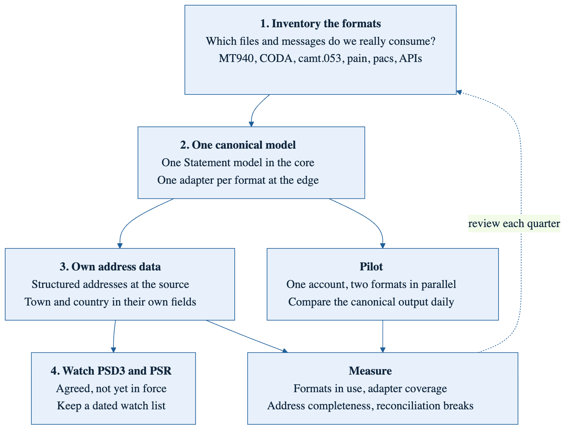

# The MT deadline passed. Your reporting stack probably didn't move


On 22 November 2025 the coexistence period for MT and ISO 20022 cross-border payment instructions on Swift came to an end, as [Swift's own update on the migration](https://www.swift.com/insights/news/iso-20022-bytes-payments-journey-continues) records. For many payment teams that date was the project: budgets, steering committees and test cycles all pointed at it. Then it passed, and I suspect plenty of those programs wound down with it.

The statement side didn't move with it. Take a finance team that still imports MT940 files from one bank, CODA from a Belgian bank, maybe a CFONB 120 or Norma 43 file from a subsidiary, and camt.053 from the bank that switched first. The deadline covered payment instructions only. The reporting files your ERP and reconciliation jobs depend on were outside it. And the next piece of work, structured postal addresses, moved its date instead of disappearing.

This article is for the tech lead or engineering manager who owns that integration. It covers the decisions you make now, what to measure and how to pilot a change, and leaves the parsing code to the repo. The samples, the Java examples and a map of how the formats relate are in the companion repo: [demystify-banking-formats on GitHub](https://github.com/wallaceespindola/demystify-banking-formats).

## The problem leaders see

Most of the confusion starts with the acronyms. ISO 20022 is the standard. pain, pacs and camt are message families inside it (customer to bank, bank to bank, bank to customer). MT and MX are two syntaxes on the Swift network. CBPR+ is a set of usage rules for cross-border payments. CODA, MT940 and the other national files are older statement formats that camt.053 is meant to replace. PSD2 is a regulation for account access, not a format at all.

When a team treats these as competing formats, every new bank or country becomes a small project of its own: a new parser, a new mapping into the ledger, a new set of reconciliation surprises. When the team treats them as layers of one stack, the same question gets a smaller answer: which layer changed, and which adapter does that touch?

So the decisions below are about structure and ownership. None of them needs a big program.

## Decision 1: inventory what you really consume

Start with a list, not an architecture. For every bank account and every system that reads bank data, write down:

- **The format and its version:** MT940, CODA (the current Febelfin specification is [version 2.7](https://febelfin.be/media/pages/publicaties/2023/febelfin-standaarden-voor-online-bankieren/5d601609cd-1754302976/standard-coda-2.7-en.pdf)), camt.053 with its namespace version, pain.001 for outgoing payments, any API feed.
- **The channel:** file transfer, host-to-host, Swift, a PSD2 account information API.
- **The consumer:** which job or system parses it, and who maintains that code.
- **The owner on the business side:** the person who notices when a statement is wrong.

Look for two things in it: formats nobody remembered were still in production, and formats parsed in more than one place. The second one is expensive, because each copy of a parser drifts on its own.

## Decision 2: one canonical model behind adapters

The structural decision is to keep one internal statement model and put one adapter per format at the edge. Reconciliation, the ledger and reporting read the canonical model only. When a bank moves you from MT940 to camt.053, you add or swap an adapter, and nothing downstream changes.

The repo shows the idea on one small statement (a 250.00 EUR credit from DUPONT SA with a Belgian structured reference). It parses the same statement from CODA, MT940 and camt.053 into one Java record and checks that the three results are equal. The samples are trimmed teaching files, not full bank output, but the last line of `make run` is the property you want in production:

```text
Same statement in all three formats: true
```

That equality check is also your migration safety net. If two adapters produce the same canonical statement for the same day, you can switch formats with evidence in hand.

There is a limit. A canonical model only holds what you decide to put in it. MT940 hides much of its detail in the free-text `:86:` field, which every bank structures differently, so the MT940 adapter will always carry more bank-specific rules than the camt.053 one. Budget for that.



## Decision 3: own address data quality

Under CBPR+, Swift planned to reject fully unstructured postal addresses in payment messages from 14 November 2026. The rule asks at minimum for town and country in their own fields, with a hybrid option that allows two free address lines of 70 characters ([Swift on the removal of unstructured addresses](https://www.swift.com/standards/iso-20022/removal-unstructured-address)). In August 2026 Swift [accepted a community request to extend the migration](https://www.swift.com/news-events/news/swift-accepts-community-request-extend-structured-address-migration-iso-20022-payment-messages): the SR 2026 release moves to 12 June 2027, and the address timing is under consultation, with an update expected by December 2026.

I'd treat that as extra time to fix the data. The problem sits in your master data: supplier records with the whole address in one field, missing towns, country codes typed by hand. No bank or vendor can fix that for you, and a translator can't create a building number that was never captured. The repo's MT103 example shows the opposite direction too: when a structured ISO 20022 address is squeezed into MT lines of 35 characters, the name and street are cut and the structure is gone.

So give the address data a named owner, usually in the team that owns supplier and customer master data, and give engineering the job of measuring it. Statements are a separate track here: per the [Swift FAQ](https://www.swift.com/standards/iso-20022/iso-20022-faqs/iso-20022-removal-unstructured-address), camt.052, camt.053 and camt.054 are excluded from the structured address rule.

## Decision 4: keep a dated watch on PSD3 and PSR

PSD2 ([Directive (EU) 2015/2366](https://eur-lex.europa.eu/eli/dir/2015/2366/oj)) is what opened account information APIs. Its successors, PSD3 and the Payment Services Regulation, reached a provisional political agreement on 27 November 2025, and when I checked, they were agreed but not yet in force ([Norton Rose Fulbright's summary](https://www.nortonrosefulbright.com/en/knowledge/publications/cedd39c6/psd3-and-psr-from-provisional-agreement-to-2026-readiness)).

I don't think a lead needs a PSD3 project today. I do think someone should own a short watch list with a date on every line: what was checked, where, and what changed. Regulation and network rules change on their own calendars, and the address deferral is a good example of a date that moved after teams had planned around it.

## What to measure

Four numbers, reviewed once a quarter, tell you whether the structure is working:

- **Formats in production:** the count from your inventory. It should go down or stay flat, never grow by surprise.
- **Adapter coverage:** the share of incoming statements that reach reconciliation through the canonical model rather than a one-off parser.
- **Address completeness:** the share of payee records with town and country in their own fields. Track it per legal entity, so you know where to start.
- **Reconciliation breaks per format:** unmatched entries grouped by the format they arrived in. A format that breaks more often is telling you where the adapter or the bank's dialect needs work.

I don't have benchmark values for any of these, and I won't invent targets. Your first quarter of measurements is the baseline.

## How to pilot it next quarter

1. **Pick one account that can arrive in two formats.** Ask the bank whether it can send camt.053 next to the MT940 or CODA file you already receive.
2. **Build the two adapters into one canonical model.** Keep the existing import running, and let the new path write to a side table.
3. **Compare the canonical output every day.** Any difference is either an adapter bug or a real difference between the formats, and you want to find both before the switch.
4. **Review at the end of the quarter.** If the outputs matched and the breaks went down, switch that account and pick the next one. If not, you've learned exactly which field disagrees.

## Wrapping up

The MT coexistence deadline closed one chapter for payment instructions. The reporting files, the address data and the next regulation are still open, and they belong to whoever owns the integration. Inventory what you consume, keep one canonical model behind adapters, give address data an owner and keep a dated watch list. None of it needs a big program. Most of it is deciding who owns what.

The samples, the Java examples and the format map are here: [github.com/wallaceespindola/demystify-banking-formats](https://github.com/wallaceespindola/demystify-banking-formats).

Which statement formats is your team still importing today, and who owns the address data behind your payments? Let me know your thoughts in the comments.

---

**Examples repository:** every example in this article (the CODA, MT940 and camt.053 statement samples, the pain.001 and pacs.008 payment samples, the Java parsers and the MT103 translation example) is in <https://github.com/wallaceespindola/demystify-banking-formats>.

Need more tech insights?
Check out my GitHub, LinkedIn, and Speaker Deck.
Happy coding!

Wallace Espindola, Solution Architect

GitHub: <https://github.com/wallaceespindola/>
LinkedIn: <https://www.linkedin.com/in/wallaceespindola/>
Speaker Deck: <https://speakerdeck.com/wallacese>
Email: <wallace.espindola@gmail.com>

**#iso20022 #payments #engineeringleadership #fintech #techleadership**
