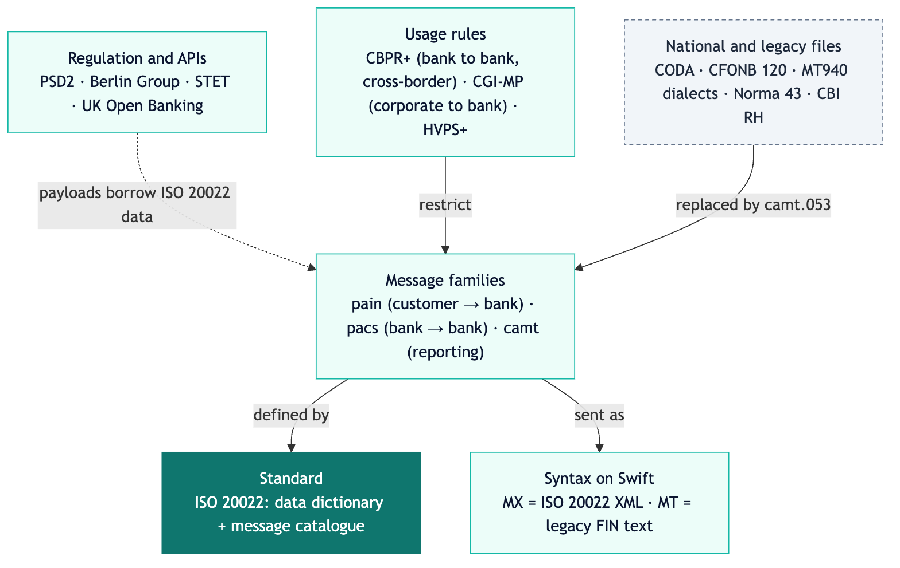
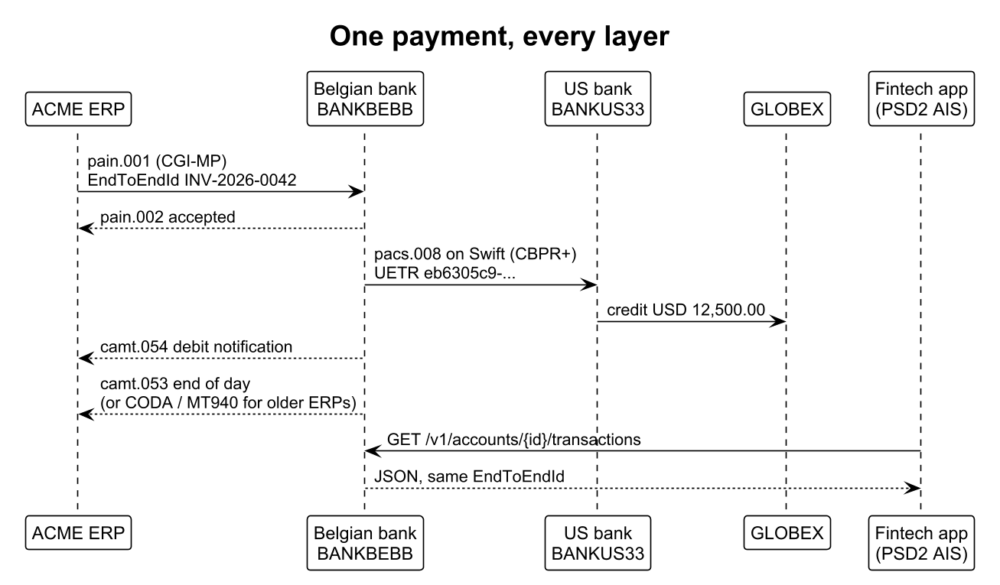
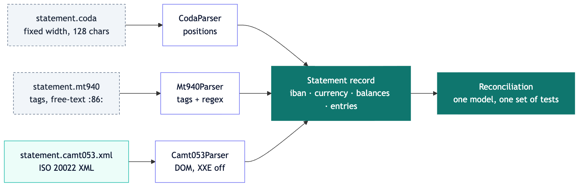

<!-- _class: lead -->
<!-- _footer: '' -->
<!-- _paginate: false -->

# Demystifying Banking Formats

## ISO 20022, pain, pacs, camt, MT, MX, CODA and PSD2 as one stack

**Wallace Espindola**
Solution Architect

<wallace.espindola@gmail.com>
linkedin.com/in/wallaceespindola | github.com/wallaceespindola

<!--
Hi, I'm Wallace. This talk is about the pile of acronyms you meet the first time you touch payments: ISO 20022, pain, pacs, camt, MT, MX, CBPR+, CODA, PSD2.
My claim is simple. They are not competing formats. They are layers of one stack, and each one answers a different question.
I'll follow one payment and one statement through every layer, show the actual files, and then the small Java code that reads three statement formats into one model. Everything is in a public repo, link at the end.
-->

---

# Ten acronyms, one payment

- **ISO 20022**, **pain**, **pacs**, **camt**
- **MT** and **MX** on the Swift network
- **CBPR+** and **CGI-MP** usage rules
- **CODA**, MT940 and other national statement files
- **PSD2** account APIs

Most material is vendor marketing or a 200-page usage guideline. The acronyms look like rivals. They are layers.

<!--
Here's the list a developer usually gets on day one, often in the same meeting.
Most of what you find online is either vendor marketing or a usage guideline of a couple of hundred pages. Neither tells you how the pieces fit together.
So people end up asking "should we use camt or CODA?" or "is PSD2 replacing ISO 20022?". Those questions mix layers. Once you see which question each acronym answers, most of the confusion goes away.
-->

---

# Six layers, six questions

| Layer | Question it answers | Examples |
| --- | --- | --- |
| Standard | Which rulebook defines the data? | ISO 20022 |
| Message family | Who talks to whom about what? | pain, pacs, camt |
| Syntax on Swift | What does it look like on the wire? | MT (FIN text), MX (XML) |
| Usage rules | Which fields and lengths are allowed here? | CBPR+, CGI-MP, HVPS+ |
| National and legacy files | What does my ERP still import? | CODA, CFONB 120, MT940, Norma 43 |
| Regulation and APIs | Who may access the account, and how? | PSD2, NextGenPSD2, STET |

<!--
This table is the whole talk in one slide.
ISO 20022 is the standard: a data dictionary and a catalogue of messages. pain, pacs and camt are message families inside it: customer to bank, bank to bank, and reporting back to the customer.
MT and MX are syntaxes on Swift. MT is the old FIN text format, MX is simply ISO 20022 XML when it travels on Swift.
CBPR+ and CGI-MP don't add new messages. They restrict the same ISO messages for a given route: CBPR+ for cross-border bank to bank, CGI-MP for corporate to bank.
CODA and its cousins are national statement files that camt.053 replaces. And PSD2 is a regulation that opened account access through APIs. It's not a message format at all.
-->

---

<!-- _class: diagram -->

# The stack as a picture



<!--
Same idea as a diagram. ISO 20022 at the bottom defines the families. Usage rules restrict them, Swift carries them as MX, and MT is the legacy syntax.
The national files on the right are the ones camt.053 replaces. The PSD2 APIs on the left are REST and JSON, but their payloads borrow ISO 20022 data elements.
If you keep this picture in mind, a new acronym usually finds its box in a few seconds.
-->

---

# One payment, one statement

- **ACME NV** in Brussels pays **GLOBEX** in the US **USD 12,500.00**
- The ERP sends a **pain.001**, the bank answers with a **pain.002**
- The bank sends a **pacs.008** over Swift under **CBPR+**, tracked by its UETR
- ACME receives **250.00 EUR** from **DUPONT SA**, reference `+++123/4567/89002+++`
- The bank reports it as **CODA**, **MT940** and **camt.053**; a fintech reads it through **PSD2**

BICs `BANKBEBB` and `BANKUS33` are fictional. Every sample file in the repo tells this same story.

<!--
To keep this concrete I use one story everywhere: in the articles, in the samples and in these slides.
ACME, a Belgian company, pays a US supplier, GLOBEX, twelve and a half thousand dollars. On the same account it receives 250 euros from a Belgian customer, with the Belgian structured reference you see here.
That one statement is delivered in three formats, which is exactly what happens at plenty of banks today. And a fintech app reads the same account through a PSD2 API.
The BIC codes are made up, and the IBAN is the usual documentation example.
-->

---

<!-- _class: diagram -->

# One payment through every layer



<!--
Here's the journey as a sequence.
The ERP sends pain.001 under CGI-MP rules and gets a pain.002 status back. The Belgian bank sends a pacs.008 to the US bank on Swift, under CBPR+, with a UETR that tracks it end to end.
Back home, ACME gets a camt.054 debit notification and an end-of-day camt.053, or CODA or MT940 if the ERP is older. And the fintech app calls the bank's account API and sees the same EndToEndId.
Six layers, one payment. Now let's open the files.
-->

---

# pain.001: three levels

```xml
<CstmrCdtTrfInitn>
  <GrpHdr>
    <MsgId>ACME-20261124-01</MsgId>
    <NbOfTxs>1</NbOfTxs>
    <CtrlSum>12500.00</CtrlSum>
  </GrpHdr>
  <PmtInf>
    <PmtInfId>BATCH-01</PmtInfId>
    <ReqdExctnDt><Dt>2026-11-24</Dt></ReqdExctnDt>
    <DbtrAcct><Id><IBAN>BE68539007547034</IBAN></Id></DbtrAcct>
    <CdtTrfTxInf>
      <PmtId><EndToEndId>INV-2026-0042</EndToEndId></PmtId>
      <Amt><InstdAmt Ccy="USD">12500.00</InstdAmt></Amt>
      ...
    </CdtTrfTxInf>
  </PmtInf>
</CstmrCdtTrfInitn>
```

Trimmed from `docs/samples/payment.pain001.xml` (pain.001.001.09)

<!--
This is the customer-to-bank payment file, trimmed from the sample in the repo.
It has three levels. The group header describes the whole file: a message id, the number of transactions and a control sum the bank checks.
Payment information is a batch: one debtor account and one execution date for everything inside it.
Then one credit transfer per payment. The EndToEndId is ACME's own reference, the invoice number here. It's the field you want to see again on the statement, so keep an eye on it.
-->

---

# pacs.008: the bank-to-bank copy

```xml
<PmtId>
  <InstrId>PAY-2026-0042</InstrId>
  <EndToEndId>INV-2026-0042</EndToEndId>
  <UETR>eb6305c9-1f7f-49de-aed0-16487c27b42d</UETR>
</PmtId>
<IntrBkSttlmAmt Ccy="USD">12500.00</IntrBkSttlmAmt>
...
<Cdtr>
  <Nm>Globex Corporation International Holdings LLC</Nm>
  <PstlAdr>
    <StrtNm>North Industrial Park Boulevard</StrtNm>
    <BldgNb>1200</BldgNb>
    <PstCd>62701</PstCd>
    <TwnNm>Springfield</TwnNm>
    <CtrySubDvsn>IL</CtrySubDvsn>
    <Ctry>US</Ctry>
  </PstlAdr>
</Cdtr>
```

Trimmed from `docs/samples/payment.pacs008.xml` (pacs.008.001.08)

<!--
The bank turns the pain.001 into a pacs.008 and sends it on Swift. On Swift we call it MX, but it's plain ISO 20022 XML.
Three identifiers sit together: the bank's InstrId, ACME's EndToEndId carried over from the pain.001, and the UETR, a UUID that tracks the payment across every bank in the chain.
Look at the creditor. The name is 45 characters, and the address is structured: street, building number, post code, town, state and country each in their own field. Remember the building number, 1200.
-->

---

# Translated back to MT103

```text
{3:{121:eb6305c9-1f7f-49de-aed0-16487c27b42d}}{4:
:20:PAY-2026-0042
:23B:CRED
:32A:261124USD12500,00
:50K:/BE68539007547034
ACME NV
Rue de la Loi 1
1000 Bruxelles BE
:59:/123456789
Globex Corporation International Ho
North Industrial Park Boulevard 120
62701 Springfield IL US
```

Trimmed output of `make run` (`Pacs008ToMt103`)

<!--
Now the same payment squeezed into an MT103 by the example translator in the repo. It's a teaching example, not a CBPR+ translator, and its Javadoc says so.
Field 59 is the creditor: an account line, then at most three more lines of 35 characters for name and address.
The name loses "ldings LLC". The street line is cut at 35 characters, so building number 1200 becomes 120. Nothing errors. The message is valid MT, and the address is wrong.
That's the kind of loss the move to ISO 20022 was meant to end.
-->

---

# What MT103 cannot carry

| pacs.008 | MT103 | In this example |
| --- | --- | --- |
| Creditor name, 45 characters | `:59:` line of 35 | "ldings LLC" cut |
| `StrtNm` + `BldgNb` | one free-text line | 1200 becomes 120 |
| `PstCd`, `TwnNm`, `Ctry` fields | free text | structure flattened |
| `EndToEndId` | no field | kept only if mapped to `:70:` |
| UTF-8 names | SWIFT X character set | none here, else replaced with `.` |

Translating MX to MT is lossy by design. Test for it instead of hoping.

<!--
Here's the list the translator prints, as a table.
Lengths are the obvious problem: 35-character lines and at most four lines for the remittance.
Structure is the less obvious one. Once street, town and country are free text, nobody downstream can reliably tell them apart, and sanctions screening reads exactly those fields.
The EndToEndId has no home in MT103 at all, so reconciliation on the creditor side gets harder.
And MT only allows the SWIFT X character set, so accented or non-Latin names get replaced. The sample has none, but the translator checks for them.
-->

---

# Same statement, three files

| | CODA | MT940 | camt.053 |
| --- | --- | --- | --- |
| Shape | Fixed width, 128 chars | Tags, `:61:` + `:86:` | ISO 20022 XML |
| Amount | 15 digits, 3 implied decimals | `C`/`D`, comma decimals | `Amt` + `CdtDbtInd` |
| Dates | DDMMYY | YYMMDD | ISO dates |
| Reference | `101` + 12 digits, by position | Inside free text | `CdtrRefInf` / `Ref` |
| Owner | Febelfin (BE), version 2.7 | Swift, bank dialects | ISO 20022 |

<!--
Now the other direction: the bank reporting back. The same 250 euro credit, in three files.
CODA is the Belgian standard from Febelfin, currently version 2.7. Every line is 128 characters and meaning comes from position.
MT940 is tag based. The structured parts are fine, but field 86 is free text and every bank fills it differently.
camt.053 is the ISO 20022 statement, and the one the other two are being replaced by. Many banks deliver more than one of these today.
Notice that even the dates differ: day-month-year in CODA, year-month-day in MT940, ISO dates in XML.
-->

---

# CODA: meaning by position

```text
0000024112672505        0000000000ACME NV                   BANKBEBB   00000000000
12001BE68539007547034                  EUR0000000001000000231126ACME NV
21000100000000000000000000000000000000000250000241126001500001101123456789002
2300010000BE71096123456769                     DUPONT SA
8001BE68539007547034                  EUR0000000001250000241126
9               000004000000000000000000000000250000
```

First 82 of 128 characters per record, from `docs/samples/statement.coda`

- Record type in column 1: `0` header, `1` old balance, `21`/`23` movement, `8` new balance, `9` trailer
- Amount `000000000250000` in 33-47 is 250.00; `101` + `123456789002` is the structured reference

<!--
This is the CODA file, cut to the first 82 characters of each record so it fits on a slide. The real lines are 128 characters, and the parser rejects anything else.
The first digit tells you the record type: header, old balance, movement parts, new balance, trailer.
In record 21 the amount sits in positions 33 to 47, fifteen digits with three implied decimals, so this is 250.00. The sign is the character just before it.
Further right, a 1 for a structured communication, then 101 and the twelve digits of the Belgian reference. Record 23 carries the counterparty, DUPONT SA.
No tags, no labels. If you're off by one column, you read the wrong number.
-->

---

# MT940: tags, and the `:86:` problem

```text
{1:F01BANKBEBBAXXX0000000000}{2:O9401700261124BANKBEBBAXXX00000000002611241700N}{4:
:20:STMT-20261124
:25:BE68539007547034
:28C:001/1
:60F:C261123EUR1000,00
:61:2611241124CR250,00NTRFNONREF//0000000000000001
:86:DUPONT SA +++123/4567/89002+++
:62F:C261124EUR1250,00
-}
```

From `docs/samples/statement.mt940`

- `:60F:` and `:62F:` are opening and closing balances, `:61:` the movement
- `:86:` is free text: the counterparty and reference are wherever this bank put them

<!--
The same statement as MT940. Tags make it easier to read than CODA: 25 is the account, 60F the opening balance, 61 the movement, 62F the closing balance.
The trouble is field 86. It's free text. This bank writes the counterparty name and then the Belgian reference with plus signs around it. German banks use question-mark subfields inside 86, others write something else.
So the parser in the repo has a regex for this one bank's dialect, and its Javadoc says that's the part every bank does differently.
-->

---

# camt.053: the same entry as XML

```xml
<Ntry>
  <Amt Ccy="EUR">250.00</Amt>
  <CdtDbtInd>CRDT</CdtDbtInd>
  <BookgDt><Dt>2026-11-24</Dt></BookgDt>
  <NtryDtls>
    <TxDtls>
      <RltdPties>
        <Dbtr><Pty><Nm>DUPONT SA</Nm></Pty></Dbtr>
      </RltdPties>
      <RmtInf>
        <Strd>
          <CdtrRefInf>
            <Tp><CdOrPrtry><Cd>SCOR</Cd></CdOrPrtry><Issr>BBA</Issr></Tp>
            <Ref>123456789002</Ref>
          </CdtrRefInf>
        </Strd>
      </RmtInf>
    </TxDtls>
  </NtryDtls>
</Ntry>
```

<!--
And the camt.053 entry, trimmed from the sample. It's longer, but nothing here needs guessing.
The amount and the credit or debit indicator are separate fields. The debtor name has its own element. The reference is structured: type SCOR, a creditor reference, issued under the Belgian scheme, BBA, and the twelve digits.
That's the whole point of ISO 20022 for reconciliation. The reference is a field, not a pattern you hope to find in free text.
-->

---

# National formats still in use

| Country | Statement file | Payment or collection file |
| --- | --- | --- |
| Belgium | CODA | none, pain.001 and pain.008 |
| France | CFONB 120 | LCR (CFONB 160) |
| Germany | MT940/MT942 dialect, via EBICS | DTAZV for non-SEPA payments |
| Spain | Norma 43 | Norma 19.14 flat file |
| Italy | CBI RH | RiBa (CBI) |

The statement files are all moving to camt.053. The payment files survive where they cover cases SEPA does not.

<!--
CODA isn't special. Every big European market has its own statement file, and they all follow the same pattern: a fixed-width or tag-based local format that camt.053 is replacing.
On the payment side, most national files were replaced by SEPA pain.001 and pain.008. The ones that remain cover something SEPA doesn't: the French LCR and Italian RiBa are collections with a due date, the German DTAZV is for non-SEPA, non-euro payments, and Spain keeps a flat-file layout for SEPA direct debits.
Belgium has no live equivalent. Payments and debits go out as pain.001 and pain.008.
The repo's context notes have a small example of each, with the warning that positions there are not exact.
-->

---

# PSD2: an access channel, not a format

- **Directive (EU) 2015/2366**: a regulation that opened account access
- Licensed third parties **read** accounts (AIS) and **initiate** payments (PIS)
- PSD2 defines no API: **Berlin Group NextGenPSD2**, **STET**, UK Open Banking do
- REST and JSON, with fields borrowed from ISO 20022: `endToEndId`, `creditorName`
- Next: **PSD3** and the **PSR**, agreed, not yet in force

The fintech sees the same payment, with the same EndToEndId, through a different door.

<!--
PSD2 gets mixed into this conversation a lot, as if it were the new format. It isn't. It's a directive that forced banks to let licensed third parties read accounts and initiate payments.
The directive doesn't define an API. Market standards do: Berlin Group NextGenPSD2 in most of the EU, STET in France, and UK Open Banking under its own regime.
They're REST and JSON, but look at the field names: endToEndId, creditorName. The data comes from ISO 20022.
PSD3 and the Payment Services Regulation reached a provisional political agreement on 27 November 2025. When I checked, formal adoption and publication weren't confirmed, so: agreed, not yet in force.
-->

---

# One model for every statement

```java
/** One bank statement, whatever file format it arrived in. Amounts are signed: credit positive, debit negative. */
public record Statement(
        String iban,
        String currency,
        BigDecimal openingBalance,
        LocalDate openingDate,
        BigDecimal closingBalance,
        LocalDate closingDate,
        List<Entry> entries) {

    /** One booked movement. {@code reference} is the structured creditor reference, digits only. */
    public record Entry(LocalDate bookingDate, BigDecimal amount, String counterparty, String reference) {}
}
```

From `examples/src/main/java/com/wallaceespindola/bankingformats/Statement.java`

<!--
On to the code. The examples are Java 25, JDK only, no parsing library.
The core is one record. A statement is an account, a currency, opening and closing balances with dates, and a list of entries. Amounts are signed, so credits are positive and debits negative, and the reference is the structured creditor reference, digits only.
Records give you equals for free, which matters on the next slides: the test is simply that all three parsers produce equal objects.
-->

---

<!-- _class: diagram -->

# Three parsers, one record



Positions, tags and XML go in. One `Statement` comes out.

<!--
Each format gets its own small adapter. The CODA parser cuts by position, the MT940 parser reads tags and uses a regex for field 86, and the camt.053 parser uses the JDK's DOM parser, namespace-version agnostic, with doctype declarations disabled so there's no XXE.
Everything after that, reconciliation and the tests, only knows the Statement record. When the bank switches you from CODA to camt.053, you swap the adapter and keep the rest.
-->

---

# CodaParser: a switch on the record type

```java
switch (line.substring(0, 2)) {
    // ... header (0), old balance (1) and part 2 (22) trimmed
    case "21" -> {                                 // movement, part 1
        if (pending != null) {
            entries.add(pending.toEntry(null));    // previous movement had no part 3
        }
        pending = new Movement(
                amount(line.charAt(31), cut(line, 33, 47)),  // sign in 32
                date(cut(line, 116, 121)),                    // entry date
                structuredReference(line));
    }
    case "23" -> {                                 // movement, part 3: counterparty
        if (pending == null) {
            throw new IllegalArgumentException("CODA record 23 without a preceding 21");
        }
        String counterparty = cut(line, 48, 82).strip();
        entries.add(pending.toEntry(counterparty));
        pending = null;
    }
```

Trimmed from `CodaParser.java`; `cut` takes 1-based positions, the way the Febelfin spec writes them

<!--
Here's the heart of the CODA parser, trimmed.
It's a switch on the first two characters with pattern guards, which reads almost like the spec's record table. Records 0 and 1 are matched on the first digit, the movement parts on both.
The small helper cut takes 1-based inclusive positions, exactly as the Febelfin document writes them, so you can check each line against the spec without doing off-by-one arithmetic in your head.
A movement is spread over records 21 and 23, so the parser keeps a pending movement and completes it when the counterparty arrives.
If a 21 has no 23, the movement is still kept, without a counterparty. A 23 with no 21 before it is a broken file, so it throws.
-->

---

# `make run`: same statement, three formats

```text
CODA     -> Statement[iban=BE68539007547034, currency=EUR, openingBalance=1000.00, ...
MT940    -> Statement[iban=BE68539007547034, currency=EUR, openingBalance=1000.00, ...
camt.053 -> Statement[iban=BE68539007547034, currency=EUR, openingBalance=1000.00, ...
Same statement in all three formats: true

Lost in translation:
  - :50K: structured address (StrtNm, BldgNb, PstCd, TwnNm, Ctry) flattened to free text
  - :59: name truncated, lost "ldings LLC"
  - :59: street truncated, lost "0"
  - :59: structured address (StrtNm, BldgNb, PstCd, TwnNm, Ctry) flattened to free text
  - EndToEndId INV-2026-0042 has no MT103 field (kept only if the bank maps it to :70:)
```

Trimmed output; `make examples` runs the JUnit 5 tests

<!--
This is the real output of make run, trimmed. The three Statement lines are long, so I cut them after the opening balance.
The line that matters is "Same statement in all three formats: true". Three very different files, one equal record.
Below it, the translator's loss report for the pacs.008 to MT103 example: both addresses flattened, the creditor name and street cut, and the EndToEndId with nowhere to go.
make examples runs the same checks as JUnit 5 tests, which is what CI runs on every push.
-->

---

# Pitfalls

- **XSD-valid is not network-valid**: CBPR+, SEPA and your bank's guide add rules on top
- **Character sets**: MT uses the SWIFT X set; accents and non-Latin names break in translation
- **Truncation** in MX to MT is a compliance problem, not a cosmetic one
- **Identifiers**: MsgId, InstrId, EndToEndId, UETR; know which one survives which hop
- **Versions**: pain.001.001.03 and .09 both still in the wild; ask your bank
- **PSD2 is not the new format**; it's an access channel to the same data

<!--
A few things that catch people.
An XML file that validates against the ISO schema can still be rejected, because usage rules and bank guides add restrictions.
MT's character set is small, so names with accents or non-Latin scripts get replaced in translation.
Truncation isn't cosmetic. Sanctions screening reads names and addresses, and a cut name or a flattened address makes that harder.
Each identifier has a job. The EndToEndId belongs to the customer, the UETR to the chain of banks. Know which one you can rely on at each step.
Message versions differ between banks, so ask which one yours takes. And don't plan a PSD2 migration as if it replaced your statement files.
-->

---

# Dates worth knowing

| Date | What happened |
| --- | --- |
| 14 July 2025 | Fedwire Funds moved to ISO 20022 in a single-day cutover |
| 9 October 2025 | Verification of Payee mandatory for euro credit transfers (Reg. 2024/886) |
| 22 November 2025 | Swift MT/MX coexistence for cross-border payment instructions ended |
| 27 November 2025 | PSD3 and PSR provisional political agreement, not yet in force |
| 14 November 2026 | CBPR+ unstructured address rejection was due; deferred in August 2026 |
| 12 June 2027 | Deferred SR 2026 release; address date under consultation |

The structured address deadline moved, it did not go away. Swift expects an update by December 2026.

<!--
These are the dates I checked against the sources listed in the repo's spec.
Fedwire Funds moved to ISO 20022 in one day, on 14 July 2025. Verification of Payee became mandatory for euro credit transfers in the eurozone on 9 October 2025, under the Instant Payments Regulation. And the MT/MX coexistence period for cross-border payment instructions on Swift ended on 22 November 2025.
The structured address rule needs care. CBPR+ was due to reject unstructured postal addresses from 14 November 2026: at minimum town and country in their own fields, with a hybrid option of two 70-character address lines. In August 2026 Swift accepted a community request to extend that migration. The deferred SR 2026 release moves to 12 June 2027, and the address timing itself is still under consultation, with an update expected by December 2026. So there's no final date yet.
One detail: camt.052, camt.053 and camt.054 are excluded from the structured address rule. It's about payment messages, not statements.
-->

---

# Wrapping up

- The acronyms are **layers**: standard, family, syntax, usage rules, national files, access
- Ask which layer a question belongs to before picking a library
- Keep **one canonical model** and write an adapter per format
- Treat MX to MT translation as **lossy**, and test for the loss
- Clean up address data now; the deadline moved, the rule stayed

Which layer is your team stuck on today?

<!--
To wrap up. The acronyms are layers of one stack, not competitors. When a new one shows up, ask which question it answers and it usually finds its place.
In code, keep one model for statements and payments, and write a small adapter per format. Migrating from CODA or MT940 to camt.053 then becomes swapping an adapter.
Treat any translation back to MT as lossy and write tests that show what gets lost.
And start structuring address data now. The date moved, but the rule did not.
I'd like to hear which layer your team is stuck on. The repo has the samples, the code, the diagrams and these slides.
-->

---

<!-- _class: lead -->
<!-- _footer: '' -->
<!-- _paginate: false -->

# Thank you

## Code, samples, diagrams and slides

[github.com/wallaceespindola/demystify-banking-formats](https://github.com/wallaceespindola/demystify-banking-formats)

**Wallace Espindola**, Solution Architect
linkedin.com/in/wallaceespindola | speakerdeck.com/wallacese

<!--
Thanks for listening. Everything I showed is in the repo: the sample files, the Java examples with tests, the diagrams and this deck. Run make run and you'll see the same output.
-->
